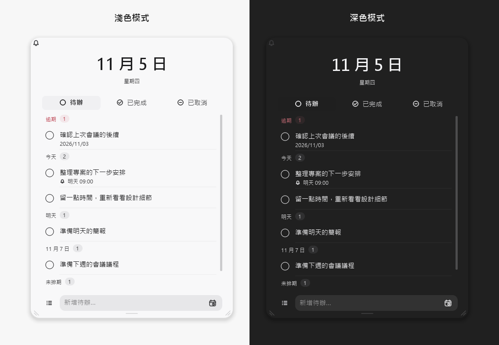
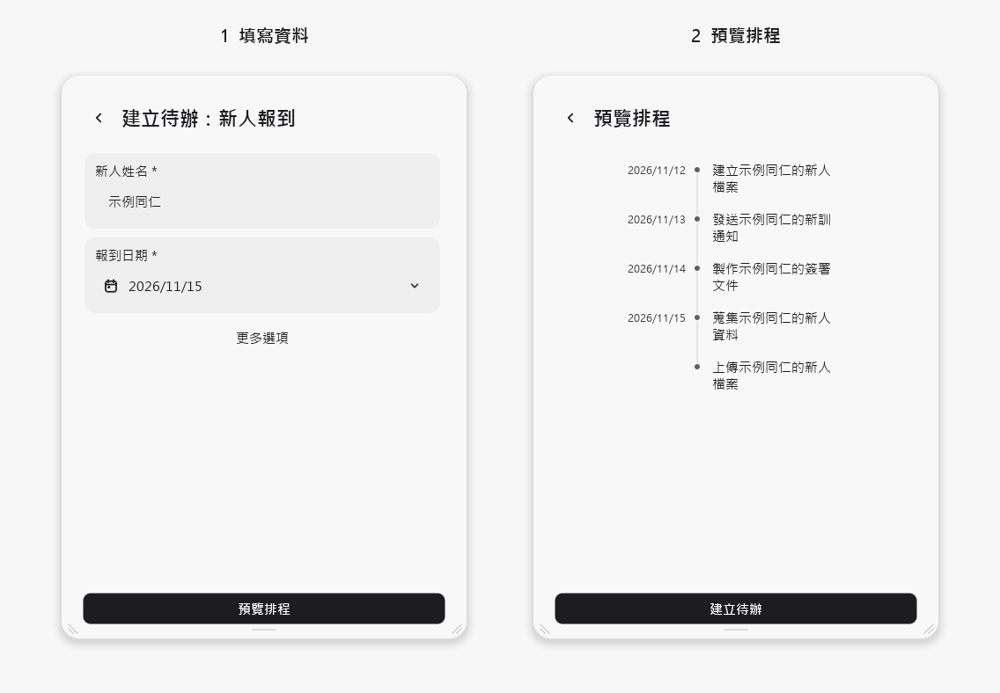

  <picture>
    <source media="(prefers-color-scheme: dark)" srcset="assets/jotdone-logo-dark.svg">
    
  </picture>

# JotDone

JotDone 是一款 Windows 桌面待辦工具。透過桌面小球快速開啟清單，整理日常事項、安排提醒，也能用模板管理重複使用的工作流程。

適合個人待辦、例行工作，以及需要追蹤多位對象進度的任務。

  

介面示意，內容為虛構資料。

## 主要功能

- **桌面小球與系統匣**：隨時開啟待辦清單，依使用習慣調整小球位置與面板收合方式。
- **待辦整理**：新增、編輯、完成或取消事項，依日期查看待辦，並保留已完成與已取消紀錄。
- **日期、提醒與重複安排**：設定到期日、提醒時間與重複週期，也可建立無日期的事項。
- **自訂模板**：設定欄位、步驟、條件與相對日期，先預覽排程，再確認建立；支援模板匯入與匯出。
- **群組進度**：將同一流程套用至多位對象，集中查看共同步驟與個別進度，並依需要調整共用排程。
- **外觀與語言**：提供淺色／深色主題、文字大小、材質與動畫設定，支援繁體中文及英文介面。

## 內建三種範例

可從模板頁的「新增 → 範例」選用：

| 範例 | 用途 |
| --- | --- |
| 新人報到 | 依報到日期安排檔案、通知與文件等準備事項 |
| 活動籌備 | 安排場地、通知、餐點與設備確認等工作 |
| 文章發布檢查 | 整理校對、圖片與連結檢查清單 |

選用範例會先開啟編輯器，調整並確認儲存後，才加入自己的模板清單。也可以從空白建立模板，自訂符合自己需求的流程。

  

以新人報到範例示範：填寫資料後先預覽排程，再確認建立待辦。

## 下載與開始使用

[下載最新版本](https://github.com/YrChen1001/JotDone/releases/latest) · [查看版本紀錄](https://github.com/YrChen1001/JotDone/releases)

1. 下載版本頁中的安裝檔，執行並依畫面完成安裝。
2. 開啟 JotDone，點擊桌面小球展開清單，輸入第一筆待辦。
3. 視需要設定日期、提醒與重複安排；有固定流程時，可建立模板，填寫資料並預覽後一次產生多個事項。

多人群組可在同一台電腦管理多位對象的進度；從群組卡片進入，即可查看共同步驟、名單與個別事項。

## 資料與提醒

待辦、模板、草稿與設定保存在本機。可在「設定 → 資料與備份」建立完整備份或從備份還原，也能查看資料所在位置。

提醒需要 JotDone 持續執行，可常駐系統匣。完整結束程式、電腦睡眠或關機期間無法即時提醒；通知是否顯示也取決於 Windows 的通知設定。

## 更新與版本說明

在「設定 → 關於 → 檢查更新」查看是否有新版本，並依畫面下載、確認安裝。也可以使用「版本說明與下載」開啟版本頁，查看更新內容及安裝檔。

此倉庫提供安裝下載、版本說明與品牌素材，應用原始碼暫不公開。
